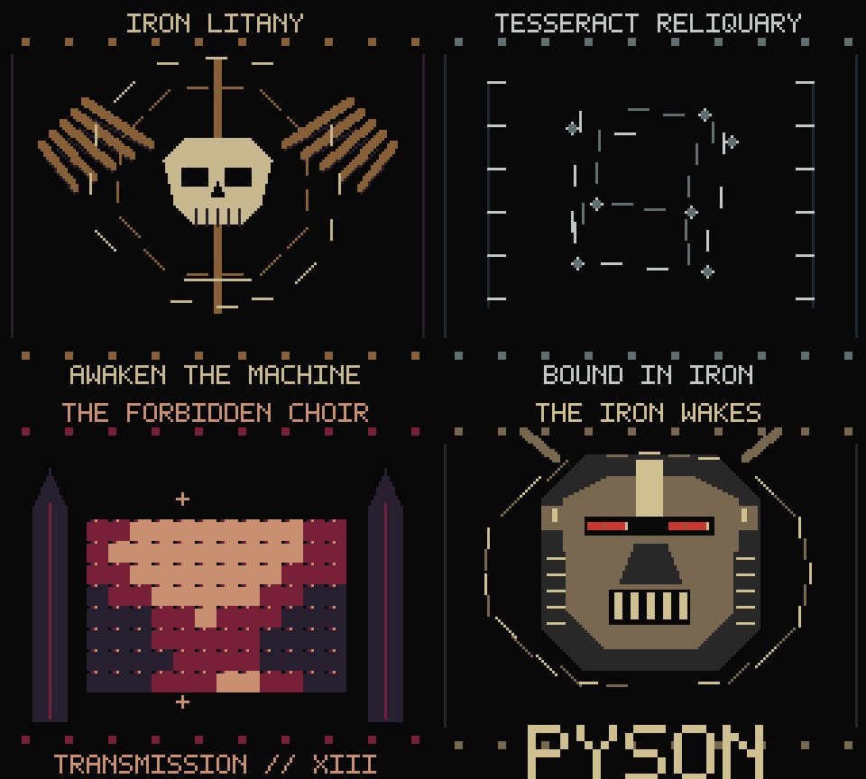

# Iron Litany

An original grimdark machine ritual for Game Boy and Game Boy Color, inspired
by gothic science fiction. Four acts replace travelling landscapes with a
winged skull seal, a rotating 3D reliquary cube, an evolving interference
display, and an armored death mask with crimson eyes above the Pyson logo.
The score combines low wave-channel bass, dissonant pulse motifs, and industrial
percussion. A show lasts about 69 seconds and loops.



## Build and play

After the normal Windows setup, run from the repository root:

```powershell
npm.cmd run build -- examples/iron-litany/main.pysn iron-litany
```

Open `binary/iron-litany.gb` in your emulator. **A** skips scenes; **Start**
pauses and resumes. The MBC5 ROM supports both monochrome and Color hardware,
uses double CPU speed on Color, and requires no battery or cartridge RAM.

## Four different presentations

1. **Awaken the Machine:** two segmented rings rotate in opposite directions
   around a winged skull. One ring breathes in and out.
2. **Tesseract Reliquary:** a cube rotates about two axes. Its corners and
   dashed edges are projected from 3D coordinates at runtime; depth changes
   edge brightness. The title names the fictional machine, not a 4D simulation.
3. **The Forbidden Choir:** a small RAM-backed tile map becomes a changing
   interference pattern. One column is rewritten per update, with markers
   following the scan. Its coarse grid and texture are deliberate.
4. **The Iron Wakes:** a large armored death mask, blinking crimson eyes,
   rotating mechanical halo, and Pyson signature.

The skull, cage, altar, and mask are prepared BMP artwork. Rotation, projection,
ring positions, interference values, blinking, and scene timing run in Pyson.
All cameras stay fixed within their scenes. The show does not use landscape
panning or a ship travelling through successive backgrounds.

## Read or modify the example

- [main.pysn](main.pysn) manages scenes, controls, and elapsed hardware frames.
- [visuals.pysn](includes/visuals.pysn) implements the four effects. Start with
  the rings in `animate()`, then try the small `interference()` function.
- [art.pysn](includes/art.pysn) declares assets and the 12-by-8 mutable display.
- [data.pysn](includes/data.pysn) holds a small sine table and cube coordinates.
  These are ordinary read-only lists, not assembly instructions.
- [palettes.pysn](includes/palettes.pysn) coordinates fades and the red eyes.
- [score.pysn](includes/score.pysn) plays the original JSON music and percussion.

The cube calculations work on four points per update, spreading the work
across updates to suit the original Game Boy. A row counter limits overlapping
sprite components. This is a hardware frame-clocked show, not a promise that
every visual effect updates at 60 FPS.

Edit the included BMPs, JSON notes, and Pyson source directly. All required
assets are supplied; building does not require an artwork generator.
Useful references: [graphics](../../documentation/graphics.md),
[mutable maps](../../documentation/mutable-maps.md),
[motion tables](../../documentation/motion-tables.md), and
[music](../../documentation/music.md).

## Verify or record

With the optional emulator environment installed:

```powershell
npm.cmd run test:litany
tools/emulator-env/Scripts/python.exe dev-tools/recordings/iron-litany.py
```

Recording also requires FFmpeg and produces `binary/iron-litany.mp4` with
synchronized audio. Tests run a complete show on both emulator models and
check audio, motion, the changing display, fixed cameras, sprite limits,
streamed artwork, and pause/skip controls. Build outputs and videos are ignored
by Git and can be recreated locally.
