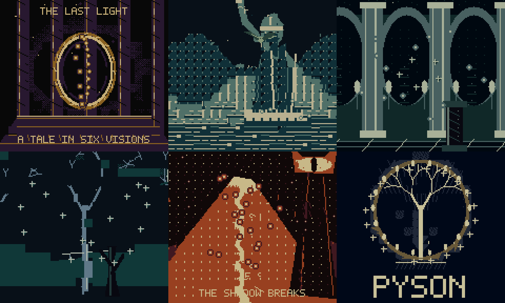

# The Last Light

A six-scene, noninteractive fantasy demo inspired by The Lord of the Rings.
It ends with Pyson beneath the White Tree and repeats automatically. Artwork
and music are original; no film clips, soundtrack recordings, or ripped game
assets are used.

```powershell
npm.cmd run build -- examples/last-light/main.pysn last-light
```

Open `binary/last-light.gb` in Game Boy or Game Boy Color mode. No buttons are
required. One show lasts about 94 seconds, including scene loads. Color gets
animated gold, green, teal, and fire palettes and double CPU speed. Original
Game Boy gets grayscale at normal speed. The cartridge uses standard MBC5,
without battery RAM, RTC, or rumble.



| Scene | What to watch |
| --- | --- |
| The forge | A golden ring, rotating perspective particles, and depth highlights |
| The river of kings | A continuous river pan, stone guardians, water lights, and an animated eagle |
| Beneath the mountain | Banked halls, an expanding particle tunnel, and faster foreground columns |
| The enchanted forest | Star-lit woodland, crossing light paths, and a separate foreground tree |
| The shadow breaks | A volcanic slope, rising embers, a watchful eye, and a darker score |
| Pyson | The White Tree, an orbit of stars, large Pyson lettering, and brighter music |

## Follow the source

[main.pysn](main.pysn) chooses scenes and measures elapsed display frames.
Each scene lasts 912 active frames. World loading with the display off falls
outside that clock, so the whole show takes slightly longer than their sum.

[visuals.pysn](includes/visuals.pysn) combines six streamed BMP worlds with
sprites, animation, and fractional camera movement. Landscapes pan in one
direction; foreground objects travel faster to suggest depth.
[palettes.pysn](includes/palettes.pysn) contains ordinary palette calls for
fades and color cycles. Monochrome keeps its fixed grayscale mapping.

[motion.pysn](includes/motion.pysn) stores prepared perspective and movement
poses in read-only ROM arrays. Pyson banks them automatically. The same
`draw_points()` helper reads each array without copying it into RAM.
Five of twenty particles change each update. Each pose uses at most three
particles on one scanline, leaving room for old/new poses and foreground art.

Packed particle values hold x in the low eight bits, y in the next seven,
and a near/far highlight in the sign bit. `-1` hides a particle. This packing
is a choice made by this advanced example; basic games can use separate x/y
arrays. Perspective is prepared content animated at runtime, rather than a
general real-time 3D renderer or an undocumented raster effect.

[score.pysn](includes/score.pysn) selects two original music parts per scene.
Kick, snare, and hat effects use the other two hardware audio channels. Audio
follows elapsed display time and is serviced regularly by drawing/audio calls.

All BMPs, music JSON, and Pyson data are included. Build directly: no asset
generation step is needed. Edit pictures in a bitmap editor and choreography
in the Pyson files. Pictures reuse a limited set of 8x8 patterns to fit the
streaming budget; adding too many unique tiles can exceed that budget.
Save systems, collision, and dialogue remain available for games; this show
concentrates on presentation features that serve its composition.

The forest background omits the earlier repeating ground marks and uses tile
reduction that preserves flat fills and avoids adding disconnected speckles.
The foreground sheet's top-left pixel is the blank background color: Pyson uses
that color for transparency, so a painted corner would make blank areas opaque.

To record the built ROM with audio, use the optional FFmpeg tool:

```powershell
tools/emulator-env/Scripts/python.exe dev-tools/recordings/last-light.py
```

It writes `binary/last-light.mp4`. See [recording setup](../../dev-tools/README.md).

## Verify the show

```powershell
npm.cmd run test:last-light
```

Requires `npm.cmd run setup:emulator`. The test builds the ROM, runs a full
loop on both hardware models, checks six distinct scenes and audio, enforces
sprite scanline limits, checks one-way pans, and guards streamed writes against
inaccessible VRAM. Emulator checks do not certify physical hardware.

References: [graphics](../../documentation/graphics.md),
[worlds](../../documentation/worlds.md),
[ROM tables](../../documentation/constant-tables.md),
[fractional movement](../../documentation/fixed-point.md),
[frame timing](../../documentation/frame-timing.md), and
[music](../../documentation/music.md).
