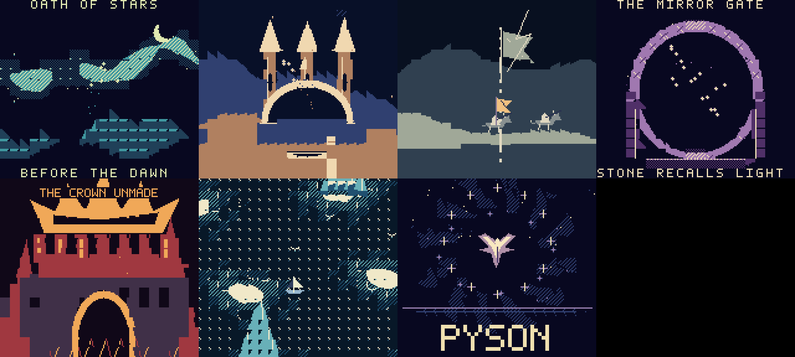

# Oath of Stars

A separate, original fantasy demo inspired by the atmosphere of The Lord of
the Rings. Seven movements build from first light to a new Pyson/phoenix finale.
It uses new artwork, sprites, compositions, and a custom wave-channel instrument.
The Last Light is unchanged.

```powershell
npm.cmd run build -- examples/oath-of-stars/main.pysn oath-of-stars
```

Open `binary/oath-of-stars.gb`. No input is needed: the approximately two-minute
show repeats. **A** skips to the next act. **Start** pauses/resumes the presentation
and music. A completed show increments a battery-backed counter. This includes
a show completed using skips. Your emulator or cartridge must retain save RAM
for that counter to survive restarting.



## The seven movements

| Movement | Presentation |
| --- | --- |
| Before the dawn | A moonlit aurora landscape and live rotating, morphing orbital light |
| The glass citadel | A long panoramic city, waterfalls, moving comets, and projected fragments |
| The riders' oath | Two animated riders, a changing pennant, seeded sparks, and a one-way landscape pan |
| The mirror gate | A carved circular gate, live orbital projection, and terrain-guided motes |
| The crown unmade | A dark fortress, restrained rising embers, and a darker musical movement |
| Beyond the grey sea | A vertical world, islands, a rocking sailboat, and a small passing bird flock |
| Pyson | A phoenix crest, sparse orbiting stars, large Pyson lettering, and a brighter musical resolution |

## What makes it different

[geometry.pysn](includes/geometry.pysn) rotates, blends, and projects 3D coordinates
on the Game Boy. It does not read a sequence of finished screen poses. Six
points change per update; older points remain visible between updates. This is
a stylized point/fragment presentation, not a filled-polygon 3D engine.
Projection remains in the opening, citadel, and mirror gate. Small depth-shaded
points replace the earlier box and triangular fragments. The crown, sea, and
finale omit that overlay to keep their silhouettes clear. The finale calculates
a sparse star orbit instead; the sea uses recognizable bird silhouettes.

The small sine table and original shape coordinates live in
[math_data.pysn](includes/math_data.pysn). An additional 8 KB table implements
`floor(value / 32)` for the bounded range -2048..2048. That saves repeated
division work while using zero working RAM. Perspective division still happens
at runtime. These bounded inputs are part of this example's design; changing
coordinate sizes requires checking the lookup range again.

The opening and gate use two areas of [veil.bmp](assets/veil.bmp), a prepared
streamed world. Its 96 reusable tile patterns include lettering aligned to
8x8 cells, leaving more patterns for the scenery. Palette choreography adds
shimmer; projection supplies live movement. The background is complete before
its first visible frame. This replaces the earlier progressively filled,
text-based fields; it does not add pixel drawing or scanline raster effects.

[actors.pysn](includes/actors.pysn) shows game systems doing visual work:

- A record array holds comet positions. A helper updates the original record.
- A reusable pool owns timed sparks and bouncing fragments.
- Seeded randomness varies their paths reproducibly.
- Rectangle overlap redirects sparks; swept terrain movement stops confined
  fragments at the rune chamber's walls.
- A mutable chamber map changes collision when its seal opens. This small
  simulation is not drawn over the carved gate; its motes remain visible.
- Sprite row counts conservatively cap fragment occupancy. The wide phoenix
  shares the display with a sparse halo of small stars.

[visuals.pysn](includes/visuals.pysn) adds streamed BMP worlds, fractional camera
movement, sprite animation, world-coordinate sprites, flipping, and palettes.
Both riders face right and travel with the camera; the small pennant follows
the foreground rider. Citadel, rider, and crown art use clean flat fills rather
than the earlier repeated texture marks. Their tile reduction preserves solid
colors exactly so blank areas cannot acquire patterned substitutions.
Approximate edge tiles also preserve the source's color set and cannot add
disconnected color regions, preventing stray dots from appearing at boundaries.
[main.pysn](main.pysn) handles states, elapsed display time, input, pause/resume,
and persistent completion counts. Modules share their state and compiled routines.

[score.pysn](includes/score.pysn) plays seven new two-voice movements. Each voice's
phrase lasts 1024 ticks, matching its act. Kick, clash, tick, and chime effects
use the other two hardware channels. Palette cues and percussion share the
sixteen-frame subdivision. The custom waveform and all composition JSON are
included under `assets/`; no recordings or earlier demo music are reused.

## Hardware and performance

The same ROM supports original Game Boy and Game Boy Color. It uses standard
MBC5 with 8 KB battery RAM; Color runs at double CPU speed and monochrome at
normal speed. Working-memory usage is intentionally close to the 4 KB budget.
The current build uses 3816 bytes, leaving 280 bytes free; ROM size is 256 KB.
All asset/data preparation is already included: build directly without a
JavaScript generation step or assembly knowledge.

This is a demanding demo rather than a claim of 60 updates per second. The
live projection is slower than simple scrolling, especially on
monochrome hardware. Elapsed-frame timing keeps musical phrases and scene
lengths aligned despite differing drawing rates. Audio remains cooperative.
Clock time excludes internal LCD-off loads between scenes.

The composition uses presentation, timing, state, input, collision, pool, map,
array, banking, and save features. Dialogue windows and choices are not inserted:
their renderer would consume more RAM and change the graphics workflow.
Cartridge options such as RTC/rumble are not visual effects.

## Test and experiment

```powershell
npm.cmd run setup:emulator
npm.cmd run test:oath
```

The test builds the ROM and runs an unmodified full show on both emulated models.
It checks all seven distinct animated/audible acts, both music voices, safe
streamed writes, sprite scanline limits, one-way camera motion, and save/reload.
It also checks complete first images, coordinated foreground fades, and
skip/pause/resume controls. Physical hardware remains untested.

To record a full loop with audio after building:

```powershell
tools/emulator-env/Scripts/python.exe dev-tools/recordings/oath-of-stars.py
```

This optional tool requires FFmpeg and uses fresh in-memory save RAM, preserving
your `.sav`. See the [recording guide](../../dev-tools/README.md). A recorded
full loop lasts about 121 seconds. Review movement and scene changes as well as
still images; correctness tests do not measure artistic quality.

Change included Pyson, BMPs, or JSON to experiment. The BMP worlds reuse 96
tile patterns each to fit the streaming working set. Arbitrary replacement
art can exceed that budget. Learn the relevant APIs in the
[graphics](../../documentation/graphics.md),
[ROM tables](../../documentation/constant-tables.md),
[records](../../documentation/records.md), [pools](../../documentation/pools.md),
[mutable maps](../../documentation/mutable-maps.md),
[movement](../../documentation/movement.md),
[frame timing](../../documentation/frame-timing.md), and
[music](../../documentation/music.md) references.
