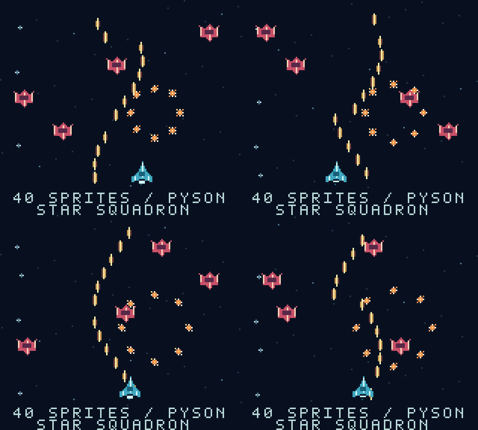

# Star Squadron

An automatic, single-screen space battle showcasing all 40 hardware sprite
slots on Game Boy and Game Boy Color. A cyan player ship weaves beneath four
enemy fighters, twelve laser bolts stream upward, and eight sparks form repeated
bursts. A scrolling starfield and looping arcade chiptune complete the scene.



## Build and play

After the normal Windows setup, run from the repository root:

```powershell
npm.cmd run build -- examples/star-squadron/main.pysn star-squadron
```

Open `binary/star-squadron.gb` in your emulator. There are no controls, scene
changes, collision rules, or win conditions: this is a sprite demonstration.
It runs continuously on monochrome and Color hardware. The 32 KiB ROM requires
no memory bank controller, external RAM, or battery save.

## Where the 40 slots go

Each hardware component is 8x8 pixels. Larger images use consecutive components.

| Object | Base slots | Components |
|---|---|---:|
| One 16x16 player ship | 0 | 4 |
| Four 16x16 enemies | 4, 8, 12, 16 | 16 |
| Twelve 8x8 bullets | 20 through 31 | 12 |
| Eight 8x8 sparks | 32 through 39 | 8 |
| **Total** | | **40** |

The starfield and fixed text use background/window tiles, so they consume no
sprite slots. The enemy rows, bullet spacing, and bounded burst radius spread
components vertically. Tests check that every component stays visible and
animated; the busiest observed scanline uses seven components, below the
hardware limit of ten.

## Follow the source

- [main.pysn](main.pysn) advances a hardware-frame clock and refreshes the screen.
- [visuals.pysn](includes/visuals.pysn) declares graphics, reserves the slot ranges,
  moves ships, and updates the bullets and sparks.
- [data.pysn](includes/data.pysn) contains a small sine table used for gentle
  movement and circular bursts.
- [score.pysn](includes/score.pysn) plays the pulse melody, wave bass, and drums.

Bullet and spark updates alternate between two groups to spread the work.
Ship positions and effect timing use elapsed hardware frames. The effects do
not all update every hardware frame; Color uses double CPU speed to update more
often than the original Game Boy.

All required BMPs are included. Edit the source or graphics directly; an asset
generator is not required to build. See [graphics](../../documentation/graphics.md)
for sprite slots and palettes, and [window graphics](../../documentation/window.md)
for fixed text over a scrolling background.

## Verify or record

With the optional emulator environment installed:

```powershell
npm.cmd run test:squadron
tools/emulator-env/Scripts/python.exe dev-tools/recordings/star-squadron.py
```

The recording command also requires FFmpeg. It records two timing cycles into
`binary/star-squadron.mp4`, about 34 seconds with synchronized audio. Tests run
both emulator models, inspect all 40 OAM components, check scanline limits and
VRAM write timing, and verify motion and audio. Build outputs and recordings
are ignored by Git.
