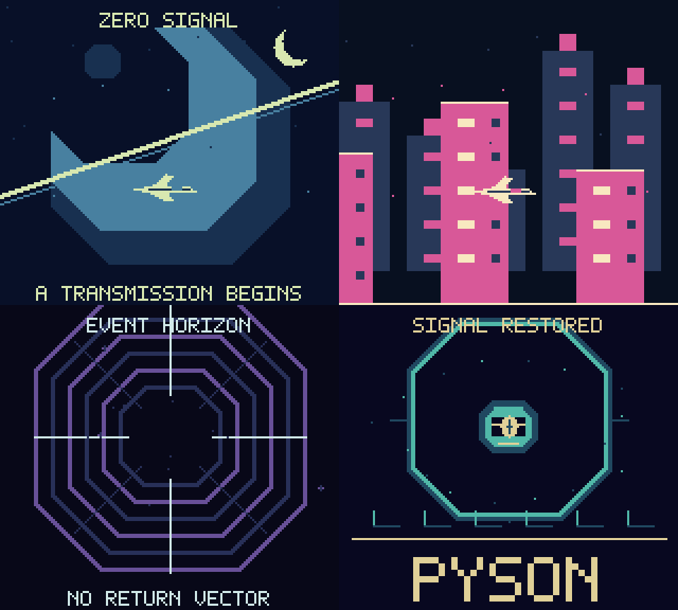

# Zero Signal

An original sci-fi music demo for Game Boy and Game Boy Color: an alien planet,
a neon orbital city, a flight into a wormhole, and an awakening machine core
above the Pyson logo. The four-part electronic score uses a pulse melody,
custom-wave bass, and percussion. A complete show lasts about 69 seconds and loops.



## Build and play

From the repository root, after the normal Windows setup:

```powershell
npm.cmd run build -- examples/zero-signal/main.pysn zero-signal
```

Open `binary/zero-signal.gb` in a Game Boy emulator. **A** skips to the next
scene; **Start** pauses or resumes. Color hardware adds scene colors and fades;
the monochrome version uses the same artwork and music. The cartridge uses
MBC5 banking, with no external RAM or battery save required.

## Follow the source

- [main.pysn](main.pysn) controls scenes, input, and elapsed time.
- [visuals.pysn](includes/visuals.pysn) loads BMP worlds and sprite sheets,
  scrolls the city, and draws moving stars, the ship, and the machine core.
- [data.pysn](includes/data.pysn) contains one small sine table for smooth motion.
- [palettes.pysn](includes/palettes.pysn) provides coordinated color fades.
- [score.pysn](includes/score.pysn) plays the original JSON compositions and drums.

The backgrounds are prepared images. Star movement, orbital positions, and the
wormhole's perspective are calculated live in Pyson. To project a star, the
program divides its horizontal and vertical offsets by its depth: approaching
stars spread outward, then respawn farther away. Records hold each star's data.

Four stars are updated per game update to spread calculation cost. A small
row counter leaves room for the foreground sprite, respecting the hardware's
ten-sprites-per-scanline limit. Elapsed hardware frames drive the music and
scene timing; this does not imply every effect updates at 60 FPS.

All artwork and score files needed to build are included. No asset generator
or JavaScript artwork workflow is required. Edit the BMPs, JSON notes, or Pyson
source directly to experiment.

## Test or record

With the optional emulator environment installed:

```powershell
npm.cmd run test:signal
tools/emulator-env/Scripts/python.exe dev-tools/recordings/zero-signal.py
```

Recording also requires FFmpeg. It produces `binary/zero-signal.mp4` with
synchronized audio. ROMs, recordings, and temporary build reports are ignored
by Git and can be recreated locally.
